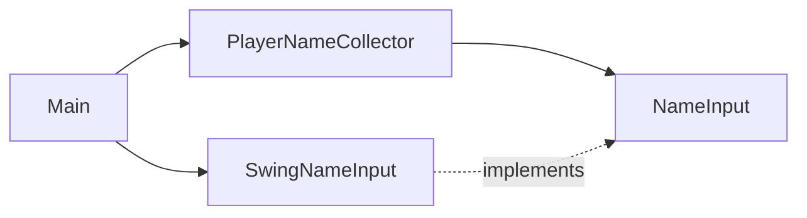

# Architecture

The program asks for a player name and stops. Nothing else exists yet.

- `app/Main` builds the parts and starts the program.
- `app/SwingNameInput` shows the Swing dialog. It is the only class that knows about Swing.
- `player/application/NameInput` is how the program asks for text. Tests use a scripted version.
- `player/application/PlayerNameCollector` asks until it gets an answer. Cancel counts as no answer, so it asks again.
  An empty or blank answer is accepted. This is the old behaviour, kept on purpose until the fix.

The old behaviour is pinned by the files in `docs/portfolio/before/`, which the tests read.
