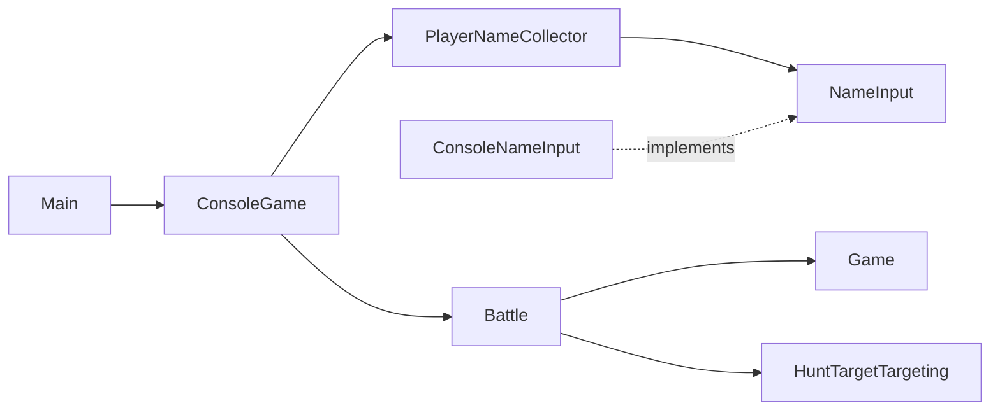

# Architecture

The program asks for a player name. The game itself lives in `game/` and is described in `docs/rules.md`.

- `app/Main` builds the parts and starts the program in the terminal.
- `app/cli/ConsoleGame` is the terminal game: name, fleet placement, battle, play again. It talks to the player only
  through `Console`, so tests can type for the player and read what was printed.
- `app/cli/BoardView` draws a board as text. `app/cli/ConsoleNameInput` asks for the name in the terminal.
- When the input ends (Ctrl+D, or the end of a piped file), the game stops at once without an error.
- `player/application/NameInput` is how the program asks for text. Tests use a scripted version.
- `player/domain/PlayerName` is a name with the spaces around it removed. A name made only of spaces is not a name.
- `player/application/PlayerNameCollector` asks for a name. A blank answer makes it ask again with a short
  explanation. Cancel ends the program without a name.

The old behaviour is pinned by the files in `docs/portfolio/before/`, which the tests read.

## The game

- `game/domain` holds the rules and nothing else: no screen, no keyboard, no randomness of its own.
  - `Coordinate` is one cell, `Placement` is one ship on the board, `Fleet` is the five ships of one side.
  - `Ocean` is a fleet together with the shots fired at it. It answers miss, hit or sunk.
  - `Sightings` is what the other side is allowed to know about an ocean: where it fired, what happened, and which
    ships sank.
  - `Game` is both oceans and whose turn it is. Every move returns a new `Game`; nothing is changed in place.
  - `FleetPlacer` places ships at random, using a `Dice` it is given, so tests can make it repeatable.
- `game/application/Battle` runs a game: your shot, then the computer's reply, chosen by a `Targeting`.
- `game/application/HuntTargetTargeting` is how the computer chooses (see "How the computer plays" in `docs/rules.md`).
  `RandomTargeting` fires anywhere it has not fired yet; tests use it as the simplest opponent.

## The browser engine

The web version does not copy the rules into TypeScript. TeaVM turns the same Java code into a JavaScript module,
`build/generated/teavm/js/battleship-engine.js`, with `./gradlew generateJavaScript`.

- `src/teavm/java/.../engine/Engine` is the list of functions the browser can call: open a session, place, remove,
  place the rest at random, clear, start, fire, rematch, read a snapshot, close.
- `Session` holds one game: the fleet being placed, then the battle. `Sessions` keeps the open ones by number.
- Every call answers with a short problem name (`OVERLAP`, `ALREADY_FIRED`, …) or an empty text when it worked.
  `snapshot` answers with the whole game as JSON, written by `Json`, so the browser never has to keep its own copy
  of the rules or of the game.

## The web app

The web app lives in `web/`. It is a React app built with Vite, and it can also be imported as one component,
`Battleship` from `web/src/app/battleship.tsx`, so the portfolio site can show it.

- `app/` puts the screens together: the name screen, then the game. The game part (placement and battle) and the
  engine load only when they are needed, and the name screen starts loading them as soon as you type or point at
  Continue.
- `features/setup` is the name screen. `features/placement` is fleet placement and `features/battle` is the battle.
  Each screen keeps its state in its own small store, made when the screen opens and dropped when it closes.
- `shared/services/engine-service.ts` loads the engine module and checks every value it returns before the app uses
  it. A value the engine should never return stops the app with an error instead of showing a wrong board.
- `shared/components/board` draws a 10 × 10 board; `shared/components/fleet-item.tsx` draws one ship in a list.
- `forest/` holds the Material 3 parts shared with the other projects: buttons, text field, dialog, snackbar, app bar.
- `shared/hooks/use-guard.ts` catches a failure in a button or board action (an engine answer the app does not
  understand) and shows the error screen with Try again, instead of leaving a screen that no longer answers.
- `shared/hooks/use-reduced-motion.ts` follows the system "reduce motion" setting. When it is on, the computer's reply
  shows at once instead of after a short pause.

The engine answers your shot and the computer's reply in one call. The battle screen shows your shot at once and the
reply a moment later, so you can follow both.
