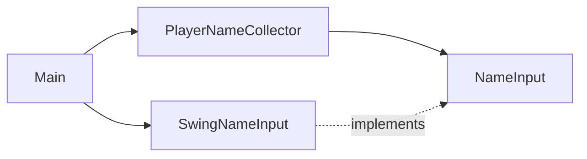

# Architecture

The program asks for a player name. The game itself lives in `game/` and is described in `docs/rules.md`.

- `app/Main` builds the parts and starts the program.
- `app/SwingNameInput` shows the Swing dialog. It is the only class that knows about Swing.
- `player/application/NameInput` is how the program asks for text. Tests use a scripted version.
- `player/domain/PlayerName` is a name with the spaces around it removed. A name made only of spaces is not a name.
- `player/application/PlayerNameCollector` asks for a name. A blank answer makes it ask again with a short
  explanation. Cancel ends the program without a name.

The old behaviour is pinned by the files in `docs/portfolio/before/`, which the tests read.

## The game

- `game/domain` holds the rules and nothing else: no screen, no keyboard, no randomness of its own.
  - `Coordinate` is one cell, `Placement` is one ship on the board, `Fleet` is the five ships of one side.
  - `Ocean` is a fleet together with the shots fired at it. It answers miss, hit or sunk.
  - `Sightings` is what the other side is allowed to know about an ocean: where it fired, what happened, and which
    ships sank.
  - `Game` is both oceans and whose turn it is. Every move returns a new `Game`; nothing is changed in place.
  - `FleetPlacer` places ships at random, using a `Dice` it is given, so tests can make it repeatable.
- `game/application/Battle` runs a game: your shot, then the computer's reply, chosen by a `Targeting`.
