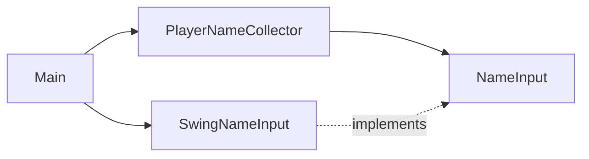

# Architecture

The program asks for a player name and stops. Nothing else exists yet.

- `app/Main` builds the parts and starts the program.
- `app/SwingNameInput` shows the Swing dialog. It is the only class that knows about Swing.
- `player/application/NameInput` is how the program asks for text. Tests use a scripted version.
- `player/domain/PlayerName` is a name with the spaces around it removed. A name made only of spaces is not a name.
- `player/application/PlayerNameCollector` asks for a name. A blank answer makes it ask again with a short
  explanation. Cancel ends the program without a name.

The old behaviour is pinned by the files in `docs/portfolio/before/`, which the tests read.
