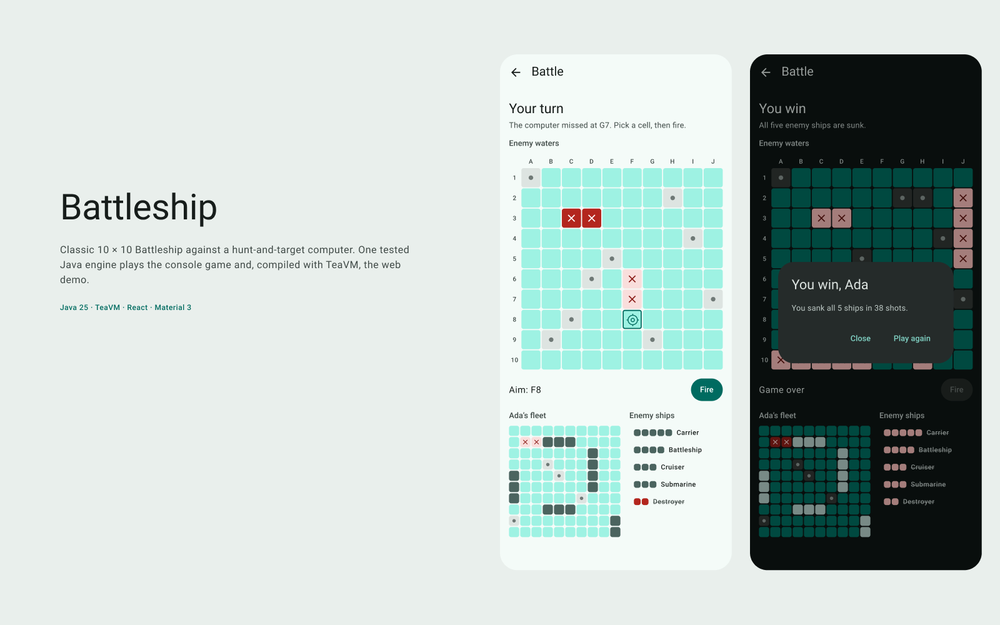
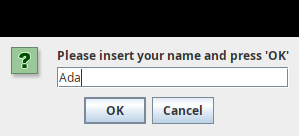
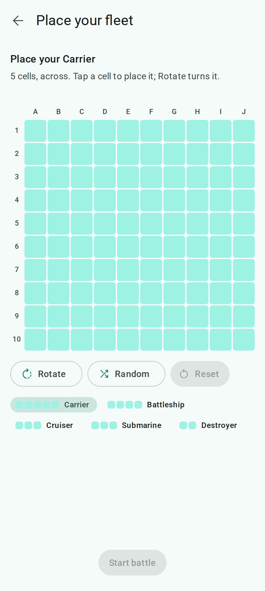
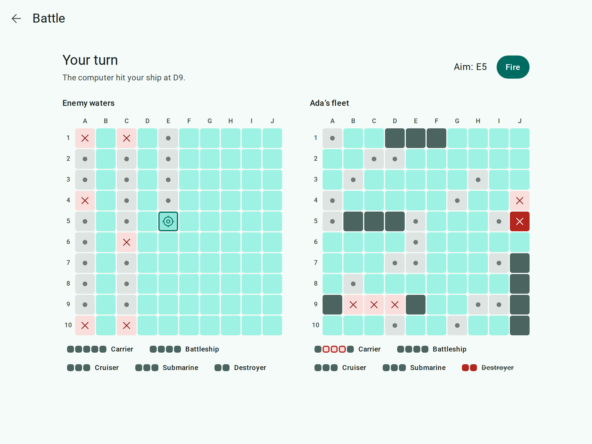
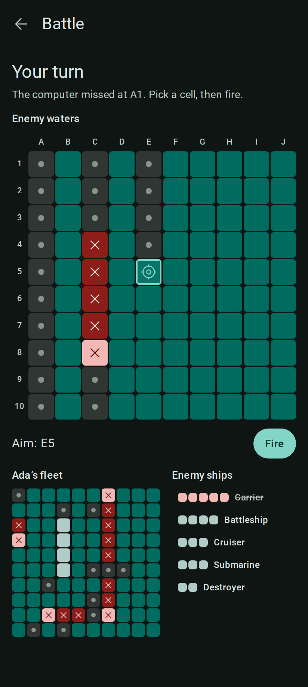
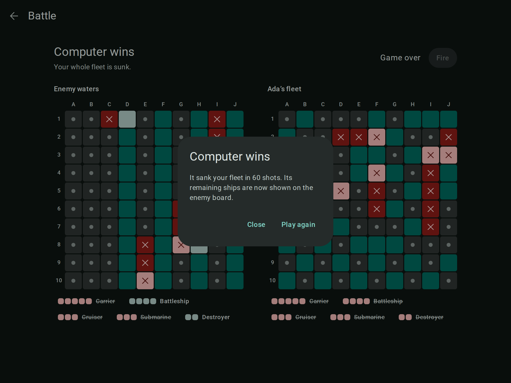

# Battleship — case study

## The problem

In 2022 I started a Battleship game in Java with Swing. What reached GitHub was two classes and 34 lines: a dialog
that asks for your name, and nothing after it. Four years later the question was: could this become a real game worth
showing, without losing the little it did?

## Before

The whole program was one dialog. It was recorded flow by flow with a small harness that types into it and clicks
its buttons, so the exact behaviour became the expected output of the first tests.

| | |
| --- | --- |
|  |  |
| **The whole game**: a name prompt. The name was stored and never used. | **Cancel**: the prompt came back, forever, with no way to quit. |

Other findings from the [audit](audit.md):

- An empty name was accepted. The check used `==`, which compares objects, not text, so it was never true.
- Compiled class files, a NetBeans jar and machine-specific IDE files (with a Windows path) were committed.
- No build tool beyond NetBeans' Ant scripts, Java 8, no tests, no README, no licence.

## Decisions

**Pin the behaviour before moving anything.** The first tests replay the recorded flows. Only once they were green was
the code moved into a standard layout, and only then was each bug fixed in its own commit, with the tests that changed
explained in [`docs/decisions.md`](../decisions.md). A blank name is now refused with a short explanation, and Cancel
ends the program.

**Build the game the stub promised.** Classic rules, written down first in plain words in
[`docs/rules.md`](../rules.md): a 10 × 10 board, five ships, one shot each, first to sink the other fleet wins. The
domain is small immutable types (a cell, a placement, a fleet, an ocean, a game), and every move returns a new game.
Randomness comes in from outside, so every test can replay the same game.

**A computer worth playing.** It only sees what a player would see. It hunts on a spaced pattern whose gap matches the
shortest ship still afloat, follows a line after a hit, and turns back at water. Over 100 test games it needs fewer
than 70 shots on average.

**One engine, two front ends.** Rather than copy the rules into TypeScript, TeaVM compiles the same Java code into a
20 kB (gzip) JavaScript module. The engine answers with plain problem names and a JSON snapshot of the game, so the
browser never keeps its own copy of the rules. The terminal game and the web app cannot drift apart.

**Design first, in Figma, on Material 3.** Every screen and state was drawn before any UI code: name, placement,
battle, win and lose, leaving a battle, loading and engine error, at phone (412), tablet (600) and desktop (1024)
widths, with dark versions. The board uses the kit's Teal colour mode: water on Primary Container, hits on Error,
misses on a neutral tile with a dot.

**Made for thumbs.** Ten columns leave 34 dp cells on a phone, below Material's 48 dp. So a tap only aims, and the
48 dp Fire button (or a second tap on the same cell) fires. Hits, misses and sunk ships each carry a mark as well as a
colour, the boards work with the arrow keys and Enter, and every shot is announced to screen readers.

**React with no effects.** The web app is React 19 with the React Compiler, a small Zustand store per screen and Base
UI for the dialog and snackbar. There is no `useEffect` in app code, and the engine and the game screens load only
when they are needed.

## After

| Phone | Desktop |
| --- | --- |
|  |  |
|  |  |

- **It plays.** A full game against the computer, in the terminal and in the browser.
- **It is tested.** 324 JUnit test cases (rules, the computer, the terminal game, the engine and the recorded 2022
  flows), 25 component, store and service tests, and browser tests that play whole games at phone and desktop widths.
- **It is checked on every pull request.** CI runs the format check, the Java build with every warning as an error,
  the TeaVM build, ESLint, the type check, the tests, a bundle-size budget and a check that no comment written for
  people slips into the code.
- **It is documented in plain words.** [`docs/rules.md`](../rules.md) explains the game,
  [`docs/architecture.md`](../architecture.md) how the parts fit, and [`docs/tooling.md`](../tooling.md) every tool.

## What I would do next

- Publish the web app so it can be played from a link.
- A harder computer that weighs every cell by how many ships could still fit there.
- Two players on two phones, with the same engine on a small server.
